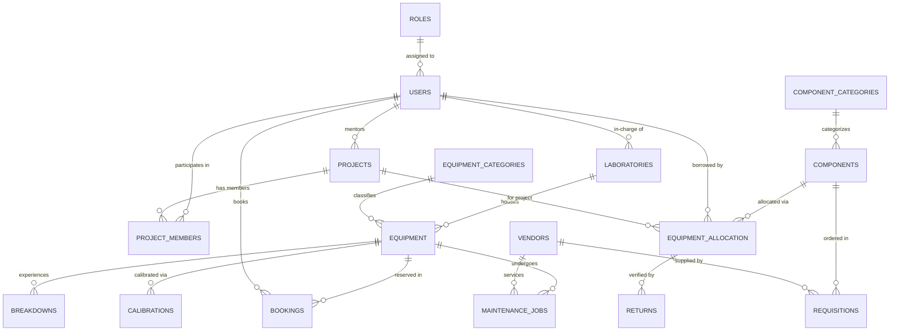

# RoboLab — Robotics Lab Management System

[](LICENSE)
[](https://www.python.org/)
[](https://palletsprojects.com/p/flask/)
[](https://www.python.org/)
[](database/)

A full-lifecycle laboratory management system designed for university robotics facilities. Built with **Python Flask** and **raw parameterized SQL** (no ORM) for a DBMS Project-Based Learning (PBL) curriculum. Fully cross-platform compatible with **Linux**, **macOS**, and **Windows**. Runs out of the box with zero configuration using auto-fallback SQLite, or with production MySQL 8.x.

---

## 📑 Reviews & Deliverables

| Document | Description |
|---|---|
| 📘 [Project Report (PDF)](25WU0101077_MohdSufiyanNaveed_DBMS_PBL_Report.pdf) | Complete project documentation, ER diagram, and schema design |
| 📊 [Review 1 Presentation](DBMS_PBL_Presentation_1.pdf) | Problem statement & requirement analysis |
| 📊 [Review 2 Presentation](ROBO_LAB_PBL_Presentation_2.pptx) | ER diagram, normalization & schema design |
| 📊 [Review 3 Presentation](ROBO_LAB_PBL_Presentation_3.pptx) | Implementation, queries & results |
| 🎥 [Video Presentation (OneDrive)](https://woxsenschoolofbusiness-my.sharepoint.com/:v:/g/personal/sufiyan_mohd_2029_woxsen_edu_in/IQBvLtEhHFYjQbPFl7azv8nQAfLhHQZBw3Wc2cWNtXp6QbY?nav=eyJyZWZlcnJhbEluZm8iOnsicmVmZXJyYWxBcHAiOiJPbmVEcml2ZUZvckJ1c2luZXNzIiwicmVmZXJyYWxBcHBQbGF0Zm9ybSI6IldlYiIsInJlZmVycmFsTW9kZSI6InZpZXciLCJyZWZlcnJhbFZpZXciOiJNeUZpbGVzTGlua0NvcHkifX0&e=NKhb7W) | Full project demonstration & walkthrough video recording |

---

## 🎥 Demonstration Video

[](https://woxsenschoolofbusiness-my.sharepoint.com/:v:/g/personal/sufiyan_mohd_2029_woxsen_edu_in/IQBvLtEhHFYjQbPFl7azv8nQAfLhHQZBw3Wc2cWNtXp6QbY?nav=eyJyZWZlcnJhbEluZm8iOnsicmVmZXJyYWxBcHAiOiJPbmVEcml2ZUZvckJ1c2luZXNzIiwicmVmZXJyYWxBcHBQbGF0Zm9ybSI6IldlYiIsInJlZmVycmFsTW9kZSI6InZpZXciLCJyZWZlcnJhbFZpZXciOiJNeUZpbGVzTGlua0NvcHkifX0&e=NKhb7W)

> 🌐 **Online Presentation Stream**: [Click here to open and watch the video presentation](https://woxsenschoolofbusiness-my.sharepoint.com/:v:/g/personal/sufiyan_mohd_2029_woxsen_edu_in/IQBvLtEhHFYjQbPFl7azv8nQAfLhHQZBw3Wc2cWNtXp6QbY?nav=eyJyZWZlcnJhbEluZm8iOnsicmVmZXJyYWxBcHAiOiJPbmVEcml2ZUZvckJ1c2luZXNzIiwicmVmZXJyYWxBcHBQbGF0Zm9ybSI6IldlYiIsInJlZmVycmFsTW9kZSI6InZpZXciLCJyZWZlcnJhbFZpZXciOiJNeUZpbGVzTGlua0NvcHkifX0&e=NKhb7W).  
> 📹 **Local Video File**: If running offline, you can also place the raw recording in [`demonstration/demonstration.mp4`](demonstration/).

---

## ⚡ Core Features

- **Machinery Lifecycle & Timeline**: Real-time status (`Available`, `In Use`, `Maintenance`, `Decommissioned`) with chronological audit history of bookings, breakdowns, and servicing.
- **Component Request Tray (Cart)**: Single-page floating cart tray in `components.html` allowing students and faculty to request multiple components for their projects in one batch without page hopping.
- **Slot Mutual Exclusion**: Strict single-user equipment access. The system detects overlapping booking requests, displays `⚠️ Competing Request(s)` badges, and automatically declines competing requests when staff approves one.
- **Faculty Priority**: Equipment booking queues prioritize faculty requests at the top above student submissions.
- **Return Verification**: Only Admin & Lab Technicians can process component returns, logging conditions (`Good`, `Damaged`, `Burnt`, `Lost`) to safely update inventory.
- **Maintenance & Calibrations**: Automated maintenance triggers on critical faults, vendor repair logging, and color-coded calibration compliance schedules.
- **SQL Query Explorer**: Pre-configured complex queries (JOINs, aggregations, subqueries) for live evaluation and viva review.

---

## 👥 Role-Based Access Control (RBAC)

| Role | Portal View | Primary Capabilities |
|---|---|---|
| **Admin** | Global Lab Dashboard | Complete authority: User account management (`/users`), procurement approval, reports, and demo data reset. |
| **Lab Technician** | Staff Lab Operations | Daily operations: Manual component issuance, return verification, slot approval, breakdown & calibration logs. |
| **Faculty** | Faculty Portal | Personal dashboard: View borrowed items, priority slot booking, supervised project teams, and component request tray. |
| **Student** | Student Portal | Personal workspace: View borrowed components & return due dates, slot reservations, and project team allocations. |

*Quick login buttons for each persona are available directly on the login screen (`/login`).*

---

## 📊 Database Architecture & ER Diagram

The database is normalized to **Third Normal Form (3NF)** with 19 relational tables and foreign-key integrity.

### Entity-Relationship Diagram


<details>
<summary><b>Click to expand raw Mermaid ER Diagram schema</b></summary>


</details>

### Table Summary (19 Tables)
`ROLES`, `USERS`, `LABORATORIES`, `EQUIPMENT_CATEGORIES`, `EQUIPMENT`, `COMPONENT_CATEGORIES`, `COMPONENTS`, `PROJECTS`, `PROJECT_MEMBERS`, `BOOKINGS`, `EQUIPMENT_ALLOCATION`, `RETURNS`, `BREAKDOWNS`, `MAINTENANCE_JOBS`, `VENDORS`, `CALIBRATIONS`, `USAGE_LOGS`, `REQUISITIONS`, `NOTIFICATIONS`.

---

## ⚙️ SQL Triggers (Automated Business Logic)

1. **`trg_after_allocation_insert`**: Immediately decrements `available_quantity` in `COMPONENTS` upon component loan issuance.
2. **`trg_after_return_insert`**: Restores component inventory only if physical return condition is `Good` or `Damaged` (usable); excludes `Burnt` or `Lost` items.
3. **`trg_after_breakdown_insert`**: Automatically flags machinery status as `Maintenance` when a `High` or `Critical` severity breakdown is logged.

---

## 🚀 Cross-Platform Setup Guide (Linux, macOS & Windows)

RoboLab is fully cross-platform compatible and runs cleanly on **Ubuntu / Debian / Linux**, **macOS (Intel & Apple Silicon)**, and **Windows 10/11**.

### 1. Clone Repository
```bash
git clone https://github.com/MSN-2007/Lab_Management-.git
cd Lab_Management-
```

### 2. Environment Setup

#### On Linux / macOS:
```bash
python3 -m venv venv
source venv/bin/activate
pip install -r requirements.txt
```

#### On Windows (PowerShell / Command Prompt):
```powershell
python -m venv venv
venv\Scripts\activate
pip install -r requirements.txt
```

### 3. Run Application

```bash
# Linux / macOS:
python3 app.py

# Windows:
python app.py
```
Visit **`http://127.0.0.1:5000`** in your browser.

> 🍎 **macOS Monterey/Ventura/Sonoma Note**: Apple uses port 5000 for AirPlay Receiver by default. You can run on any port (e.g. 5001) seamlessly:
> ```bash
> PORT=5001 python3 app.py
> ```
> 💡 **Zero Setup Required**: Automatically boots using the pre-seeded `database/robolab.db` SQLite file. To use MySQL 8.x instead, configure your credentials in `.env` (see `.env.example`).

---

## 📁 Project Structure

```
SQL_PBL/
├── app.py              # Cross-platform Flask app routes, views & authorization
├── db.py               # Database connector & execution layer (MySQL + SQLite)
├── config.py           # Cross-platform configuration & environment parser
├── requirements.txt    # Application dependencies
├── mermaid-diagram.png # High-resolution ER diagram
├── demonstration/      # Dedicated directory for video walkthrough files (.mp4)
│   └── README.md       # Video format & upload instructions
├── database/
│   ├── schema.sql      # DDL table creation, views & trigger definitions
│   ├── seed.sql        # Realistic demonstration dataset
│   ├── queries.sql     # Pre-written review & viva queries
│   └── robolab.db      # Pre-seeded SQLite database
├── static/             # Dark theme stylesheets, offline FontAwesome, scripts
└── templates/          # Jinja2 templates (dashboard, bookings, cart, inventory)
```

---

## 📄 License
This project is open-source under the [MIT License](LICENSE).
