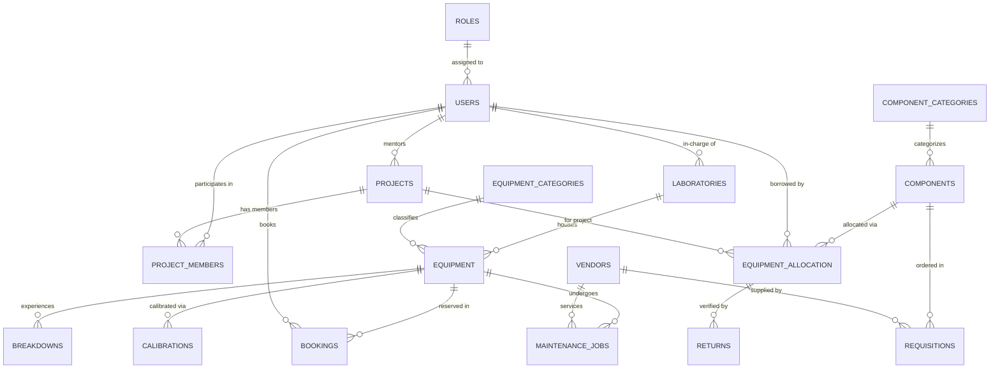

# RoboLab — Robotics Lab Management System

[](LICENSE)
[](https://www.python.org/)
[](https://palletsprojects.com/p/flask/)
[](database/)

A full-lifecycle laboratory management system designed for university robotics facilities. Built with **Python Flask** and **raw parameterized SQL** (no ORM) for a DBMS Project-Based Learning (PBL) curriculum. Runs out of the box with zero setup using auto-fallback SQLite, or with production MySQL 8.x.

---

## 🎥 Demonstration Video

<!-- Embed or link your lab walkthrough / presentation recording below -->

[](https://www.youtube.com/watch?v=YOUR_VIDEO_ID)

> 📹 **Video Demo**: *Click the banner above to watch the end-to-end system walkthrough, role portals, request cart, and slot conflict resolution in action.*  
> *(To use a local video file instead, replace with: `<video src="demo_video.mp4" controls width="100%"></video>`)*

---

## ⚡ Core Features

- **Machinery Lifecycle & Timeline**: Real-time status (`Available`, `In Use`, `Maintenance`, `Decommissioned`) with chronological audit history of bookings, breakdowns, and servicing.
- **Component Request Tray (Cart)**: Single-page floating cart tray in `components.html` allowing students and faculty to request multiple components for their projects in one batch.
- **Slot Mutual Exclusion**: Strict single-user equipment access. The system detects overlapping booking requests, displays `⚠️ Competing Request(s)` badges, and automatically declines competing requests when staff approves one.
- **Faculty Priority**: Equipment booking queues prioritize faculty requests at the top above student submissions.
- **Return Verification**: Only Admin & Lab Technicians can process component returns, logging conditions (`Good`, `Damaged`, `Burnt`, `Lost`) to safely update inventory.
- **Maintenance & Calibrations**: Automated maintenance triggers on critical faults, vendor repair logging, and color-coded calibration compliance schedules.
- **SQL Query Explorer**: Pre-configured complex queries (JOINs, aggregations, subqueries) for live evaluation and viva review.

---

## 👥 Role-Based Access Control (RBAC)

| Role | Portal View | Primary Capabilities |
|---|---|---|
| **Admin** | Global Lab Dashboard | Complete authority: User account management (`/users`), procurement approval, reports, and demo data reset. |
| **Lab Technician** | Staff Lab Operations | Daily operations: Manual component issuance, return verification, slot approval, breakdown & calibration logs. |
| **Faculty** | Faculty Portal | Personal dashboard: View borrowed items, priority slot booking, supervised project teams, and component request tray. |
| **Student** | Student Portal | Personal workspace: View borrowed components & return due dates, slot reservations, and project team allocations. |

*Quick login buttons for each persona are available directly on the login screen (`/login`).*

---

## 📊 Database Architecture & ER Diagram

The database is normalized to **Third Normal Form (3NF)** with 19 relational tables and foreign-key integrity.

### Entity-Relationship Diagram


<details>
<summary><b>Click to expand raw Mermaid ER Diagram schema</b></summary>


</details>

### Table Summary (19 Tables)
`ROLES`, `USERS`, `LABORATORIES`, `EQUIPMENT_CATEGORIES`, `EQUIPMENT`, `COMPONENT_CATEGORIES`, `COMPONENTS`, `PROJECTS`, `PROJECT_MEMBERS`, `BOOKINGS`, `EQUIPMENT_ALLOCATION`, `RETURNS`, `BREAKDOWNS`, `MAINTENANCE_JOBS`, `VENDORS`, `CALIBRATIONS`, `USAGE_LOGS`, `REQUISITIONS`, `NOTIFICATIONS`.

---

## ⚙️ SQL Triggers (Automated Business Logic)

1. **`trg_after_allocation_insert`**: Immediately decrements `available_quantity` in `COMPONENTS` upon component loan issuance.
2. **`trg_after_return_insert`**: Restores component inventory only if physical return condition is `Good` or `Damaged` (usable); excludes `Burnt` or `Lost` items.
3. **`trg_after_breakdown_insert`**: Automatically flags machinery status as `Maintenance` when a `High` or `Critical` severity breakdown is logged.

---

## 🚀 Quick Start Guide

### 1. Clone & Setup
```bash
git clone https://github.com/MSN-2007/Lab_Management-.git
cd Lab_Management-

# Create virtual environment
python -m venv venv
venv\Scripts\activate       # Windows
# source venv/bin/activate  # Linux/macOS

# Install dependencies
pip install -r requirements.txt
```

### 2. Run Application
```bash
python app.py
```
Visit **`http://127.0.0.1:5000`** in your browser.

> 💡 **Zero Setup Required**: The application automatically detects and boots using the pre-seeded `database/robolab.db` SQLite database. To use MySQL 8.x instead, configure your credentials in `.env` (see `.env.example`).

---

## 📁 Project Structure

```
SQL_PBL/
├── app.py              # Flask application routes, views & authorization
├── db.py               # Database connector & execution layer (MySQL + SQLite)
├── config.py           # Configuration & environment variable parser
├── requirements.txt    # Application dependencies
├── mermaid-diagram.png # High-resolution ER diagram
├── database/
│   ├── schema.sql      # DDL table creation, views & trigger definitions
│   ├── seed.sql        # Realistic demonstration dataset
│   ├── queries.sql     # Pre-written review & viva queries
│   └── robolab.db      # Pre-seeded SQLite database
├── static/             # Dark theme stylesheets, offline FontAwesome, scripts
└── templates/          # Jinja2 templates (dashboard, bookings, cart, inventory)
```

---

## 📄 License
This project is open-source under the [MIT License](LICENSE).
